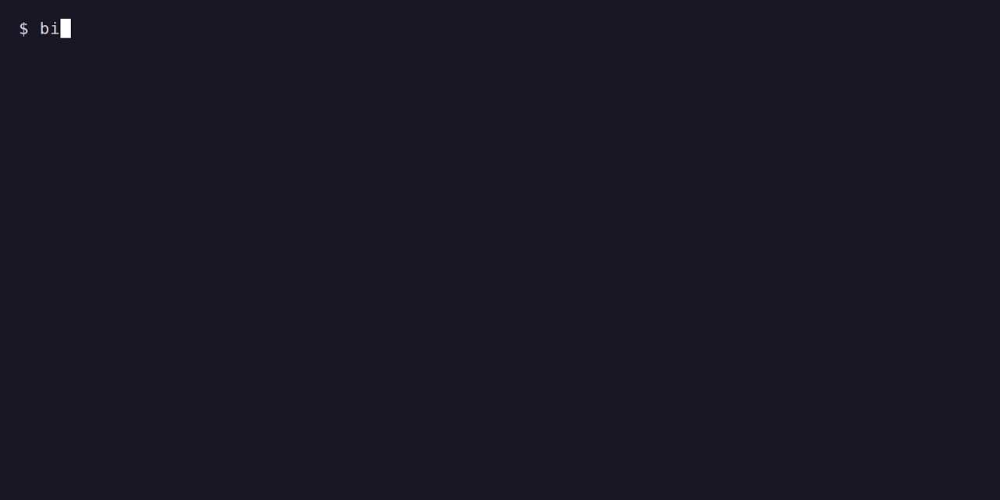
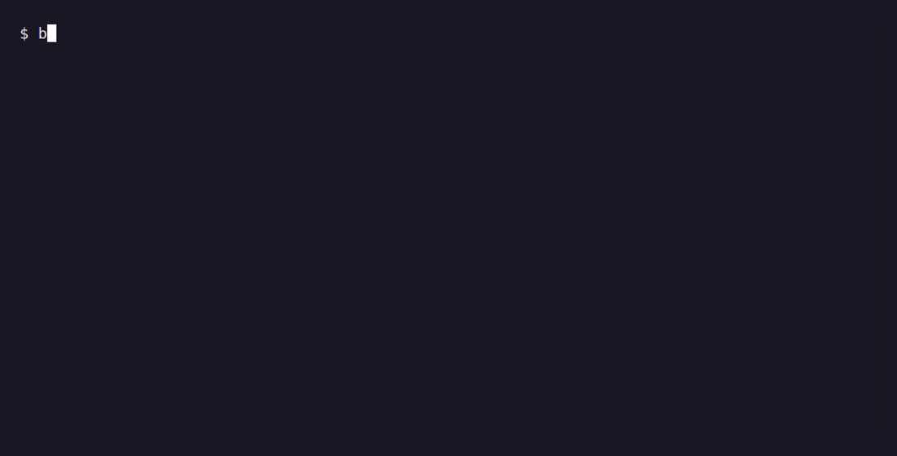

# agent-kit

agent-kit adds a set of ready-made settings, helpers and instructions to Claude Code, so a new setup works more like one that has been tuned over months of daily use. It has five core modules and four optional add-ons from other projects. You can install all of them or pick the ones you want, and the uninstall command removes everything it added and puts back any file it replaced.

It is written for people who have tried Claude Code a few times and want a better starting point, without first learning every setting.



## What's in it

| Module | What it does |
| --- | --- |
| base | Adds a starter `~/.claude/CLAUDE.md` (the file Claude reads at the start of every session, where you describe how you like to work), puts the `agent-kit` command on your PATH and sets your default model to Opus or Sonnet. Always installed. |
| lean | Adds four subagents, smaller helpers that Claude can hand part of a task to: a scoper that maps out unfamiliar code, an implementer that writes code from a finished plan, a reviewer that checks risky changes, and a shipper that commits and opens pull requests when you ask. It also sets Opus and Sonnet to medium effort, which uses less of your plan's usage for most everyday work. |
| usage | Shows your model and how much of your 5-hour and weekly usage you have used at the bottom of Claude Code. It also adds the local time and those numbers to every message you send, so Claude can keep work smaller when you are close to a limit. |
| look | Sets a dark theme, picks an editor for long prompts, turns on tips, turns off automatic continuing when you hit a usage limit, keeps 90 days of history and lets Claude run a few harmless commands (`git status`, `git log`, `git diff`, `ls`) without asking each time. |
| crew | Optional. Helpers for Herdr, a separate app that runs several coding agents side by side. See [Herdr and the crew](#herdr-and-the-crew-optional). Installing crew also installs lean. |


### Add-ons from other projects

These install tools and skills written by other people. They are left out of a plain `install --yes`, so you only get them if you name them, for example `--modules writing,plannotator`. Before each one, the kit shows where it comes from and the exact command it will run, and asks first (`--yes` answers yes for you). Most of them need [Node.js](https://nodejs.org), which provides the `npx` command.

| Add-on | What you get |
| --- | --- |
| plannotator | [Plannotator](https://github.com/backnotprop/plannotator), which opens Claude's plans and code changes in your browser so you can mark them up and send notes back. |
| design | Design skills: [impeccable](https://github.com/pbakaus/impeccable) for building and reviewing interfaces, a local copy of Apple's Human Interface Guidelines, and lavish-axi for reviewing HTML pages Claude makes. Needs Python 3 as well. |
| writing | Writing and planning skills: humanizer (rewrites text that sounds AI-written), grill-me and handoff, plus the i-have-adhd plugin. |
| devtools | Helpers that let Claude work with GitHub (gh-axi) and Chrome (chrome-devtools-axi), rtk for shorter command output, and Cloudflare's plugin. |

## The quick way: let Claude install it

If you already have Claude Code, the easiest start is to open it and paste in the contents of [GIVE_THIS_TO_YOUR_AGENT.md](GIVE_THIS_TO_YOUR_AGENT.md). Claude then checks your system, asks which modules you want and which model to use day to day, shows each command before it runs it, installs the kit, runs the checkup and offers the interview described in [Make it yours](#make-it-yours). It never reads your login or keys.

The rest of this page explains the same steps by hand.

## Before you start

### On Windows: install WSL first

agent-kit is a set of bash scripts, so on Windows it runs inside WSL (Windows Subsystem for Linux), which gives you a Linux terminal on your Windows PC. Claude Code also works well there.

There is a Windows installer, `install.ps1`, that sets up WSL and Ubuntu, picks up again after the restart and then installs the kit. It is new and has only been tried in its practice mode, which prints each step without doing it. If you want to try it, download it, read it, and do a practice run first, all in PowerShell opened as administrator:

```powershell
irm https://raw.githubusercontent.com/metzrock/agent-kit/v0.1.0/install.ps1 -OutFile install.ps1
notepad install.ps1
powershell -ExecutionPolicy Bypass -File .\install.ps1 -DryRun
powershell -ExecutionPolicy Bypass -File .\install.ps1
```

The steps below are the tested way to do it by hand.

1. Open PowerShell as administrator (right-click the Start button, then "Terminal (Admin)").
2. Run:

   ```powershell
   wsl --install
   ```

3. Restart your PC when it asks.
4. Open "Ubuntu" from the Start menu. The first time, it asks you to pick a Linux username and password. The password is only for this Linux system; you will type it when a command starts with `sudo`.

Do every step after this inside the Ubuntu window. Keep your projects in your Linux home folder (`~`, which is `/home/<your-name>`) and not under `/mnt/c/`, because Windows folders are much slower from inside WSL.

### Install git, jq and curl

The kit needs three small command-line tools.

On Ubuntu (WSL) or Debian:

```bash
sudo apt update && sudo apt install -y git jq curl
```

On macOS, git and curl are already there. Install jq with [Homebrew](https://brew.sh):

```bash
brew install jq
```

### Claude Code

If you don't have Claude Code yet, follow the [official setup guide](https://code.claude.com/docs/en/setup), or let the kit run the official installer for you with `--upstream` (see the next section). On Windows, install it inside the Ubuntu window, not in PowerShell.

## Install

On Linux, macOS or inside WSL, one command downloads the latest release into `~/.local/share/agent-kit` and starts the installer:

```bash
curl -fsSL https://raw.githubusercontent.com/metzrock/agent-kit/v0.1.0/install.sh | bash
```

Anything you add after `bash -s --` goes to the installer, for example `| bash -s -- --modules usage,look --yes`. If you'd rather read the script before running it, download it with `curl -fsSL <same address> -o install.sh`, open it, then run `bash install.sh`.

### Install by hand

```bash
git clone https://github.com/metzrock/agent-kit.git ~/agent-kit
cd ~/agent-kit
```

See what would be installed, without changing anything:

```bash
bin/agent-kit install --dry-run
```

Install all five modules:

```bash
bin/agent-kit install --yes
```

When it finishes, start Claude Code with `claude` and sign in if you haven't already. The kit never asks for, stores or handles your login.

If `agent-kit` isn't found in a new terminal after installing, `~/.local/bin` isn't on your PATH yet. Close and reopen the terminal, or run `bin/agent-kit` from the kit folder instead.

### Install options

Pick modules instead of installing all of them. base is always included, and crew brings lean with it:

```bash
bin/agent-kit install --modules usage,look --yes
```

Use Sonnet as your default model instead of Opus (Sonnet is faster and uses less of your plan):

```bash
bin/agent-kit install --model sonnet --yes
```

Run the official installers for anything missing. This installs Claude Code if it isn't there, and Herdr if you are installing crew. It shows you each install command and asks before every download:

```bash
bin/agent-kit install --upstream
```

## Check that it worked

```bash
agent-kit doctor
```

Each line starts with a word that tells you what it found:

| Word | Meaning |
| --- | --- |
| `OK` | A required tool is installed. |
| `MISSING` | A required tool, or a command your Claude settings point to, can't be found. Install it and run `doctor` again. |
| `BROKEN` | A file the kit linked has been moved or deleted. Run `agent-kit update` to put it back. |
| `USER-OWNED` | The kit skipped a path because it sits inside a folder you manage yourself (a symlinked folder). Nothing is wrong. |
| `OPTIONAL` | An extra tool isn't installed: `claude`, `herdr`, or `gum` (which gives `agent-kit customize` nicer menus). |

To see which modules are installed:

```bash
agent-kit list
```

## What changes in Claude Code

With the usage module, the bottom of Claude Code shows your model and how much of your usage limits you have used, for example `Opus 5.5 · 5h 23% · wk 41%`. "5h" is the rolling five-hour limit and "wk" is the weekly one. Each message you send also carries a short note with the local time and the same numbers. You don't see the note, but Claude reads it, and the kit's instructions tell it to keep work focused and ask before taking on more when usage is high.


With lean installed, Claude decides when to use the subagents, and you can also ask for one by name, for example "have the scoper look at how payments work first" or "get the reviewer to check this before I merge". The implementer handles well-defined coding jobs from a plan, and Claude reviews its changes and runs the checks itself afterwards. The shipper only commits or pushes when you ask it to.

A few Claude Code commands are worth knowing, and the kit's instructions refer to them:

| Command | What it does |
| --- | --- |
| `/model` | Switch between Opus, Sonnet and Haiku for this session. |
| `/effort` | Change how much thinking Claude does. Lower is faster and uses less. |
| `/clear` | Start fresh. Use it when you switch to unrelated work. |
| `/compact` | Shrink the conversation so far into a summary and keep going on the same task. |

`agent-kit tips` prints a short reminder of these.

## Herdr and the crew (optional)

[Herdr](https://herdr.dev) is a separate app that runs coding agents in their own terminals, in panes and tabs, and keeps them working when you close the window. You don't need it to use the rest of the kit, so it makes sense to get comfortable with Claude Code on its own first.

The crew module builds on Herdr. When you ask for "the crew" on a coding task, your main Claude session acts as the lead: it plans the work and writes instructions, while helper agents in other Herdr panes look through the code, write the changes and review them. The work ends as a reviewed commit on its own git branch, and nothing is pushed or merged without you.

To set it up, install crew with `--upstream` so the kit can install Herdr too (on Windows, do this inside WSL like everything else):

```bash
bin/agent-kit install --modules crew --upstream
```

Then start Claude Code inside a Herdr pane and ask it to use the crew. The helper that writes code is Sonnet by default. If you also use OpenAI's Codex, you can switch it by changing `CREW_IMPLEMENTER` in `~/.config/agent-kit/config`.

The kit's Herdr settings turn on arrow keys and mouse support. The keys to start with: press `ctrl+b`, then an arrow key to move between panes, or `ctrl+b`, then `v` to split the screen.

## Make it yours

Open `~/.claude/CLAUDE.md` and describe your goals and how you like to work. Claude reads it at the start of every session. It's your file: the kit never overwrites it.

If you'd rather not write it from scratch, run:

```bash
agent-kit interview
```

This starts Claude Code on Sonnet, which uses less of your plan, and asks you a few questions at a time: about you, how you want Claude to work, how careful to be with usage, and how you like to stay focused. It then shows you a draft `CLAUDE.md`, and only writes it after you agree, keeping a backup of the old one. Run it again later to redo one section.

To pick a different Claude theme, Herdr theme or Herdr key, run:

```bash
agent-kit customize
```

It shows the settings it is about to change and asks before applying them.

## What it changes on your computer

- It links its files into `~/.claude/` (subagents, rules and skills) and `~/.local/bin/` (commands), so they always point at the copy in the kit folder.
- It adds its settings to `~/.claude/settings.json` and keeps everything else in that file as it was.
- A few files are copied in for you to edit: `~/.claude/CLAUDE.md`, `~/.config/agent-kit/config` and `~/.config/herdr/config.toml`. The kit only creates them when they don't exist, and from then on they are yours.
- Before it replaces or changes any file, it saves a copy in `~/.local/state/agent-kit/backups`, named with the date and time.
- It keeps a record of everything it did in `~/.config/agent-kit/state.json`. That record is what lets it undo its changes exactly.

## Update and uninstall

```bash
agent-kit update
```

This moves the kit to its newest release and refreshes the installed modules. If a newer version of a file you own (like `CLAUDE.md`) is available, it shows you the difference and asks before using it. It then runs `doctor`.

To remove everything:

```bash
agent-kit uninstall
```

This removes the kit's files and settings and puts back the files it replaced. Your backups stay in `~/.local/state/agent-kit/backups`.

You can also remove a single module, for example `agent-kit uninstall usage`. Remove crew before lean, and base last.



## Troubleshooting

"another agent-kit command is running" means a lock folder is left over from a command that was interrupted. Make sure no other `agent-kit` command is running, then remove it:

```bash
rmdir ~/.config/agent-kit/.lock
```

`MISSING settings command` from `doctor` means your Claude settings point to a command that no longer exists, often because the kit folder was moved or deleted. Put the folder back where it was, then run `agent-kit doctor` again.

On Windows, if commands are slow or files seem to go missing, check that the kit and your projects are in your Linux home folder (`~`) and not under `/mnt/c/`.

## Development

Run the tests and checks before sending a change. CI runs the same three on every push:

```bash
tests/run          # test suite (needs bats)
tools/lint         # shellcheck
tools/leak-check   # looks for personal paths, addresses and secrets
```

The demo GIFs are recorded with [VHS](https://github.com/charmbracelet/vhs) in a throwaway home folder. To record one again, run from the repo root:

```bash
vhs docs/demo/install.tape
```

## License

MIT. See [LICENSE](LICENSE).
